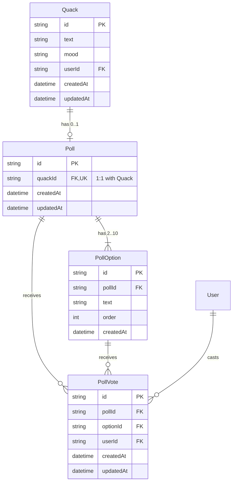

# Implementation Plan: Polls

## 1. Overview & Goals

Enable Quacker users to attach a poll to a quack, cast a single vote, switch their vote, or retract their vote.
Voting must feel instantaneous (optimistic UI), handle errors gracefully (rollback + toast error), and guarantee consistency at the database level (at most one vote per user per poll).

---

## 2. Data Model

### Database Tables (PostgreSQL via Prisma)



### Table Definitions & Constraints

1. **`poll` table** (`Poll` model)
   - `id`: `String` `@id @default(cuid())`
   - `quackId`: `String` `@unique` (Foreign key to `quack.id` with `onDelete: Cascade`)
   - `createdAt`: `DateTime @default(now())`
   - `updatedAt`: `DateTime @default(now()) @updatedAt`

2. **`poll_option` table** (`PollOption` model)
   - `id`: `String` `@id @default(cuid())`
   - `pollId`: `String` (Foreign key to `poll.id` with `onDelete: Cascade`)
   - `text`: `String @db.VarChar(100)` (Answer choice text)
   - `order`: `Int @default(0)` (Maintains original option ordering)
   - `createdAt`: `DateTime @default(now())`
   - **Constraints**:
     - `@@unique([pollId, id])`
     - `@@index([pollId])`

3. **`poll_vote` table** (`PollVote` model)
   - `id`: `String` `@id @default(cuid())`
   - `pollId`: `String` (Foreign key to `poll.id` with `onDelete: Cascade`)
   - `optionId`: `String` (Foreign key to `poll_option` composite `[pollId, id]` with `onDelete: Cascade`)
   - `userId`: `String` (Foreign key to `user.id` with `onDelete: Cascade`)
   - `createdAt`: `DateTime @default(now())`
   - `updatedAt`: `DateTime @default(now()) @updatedAt`
   - **Database Enforcement of One Vote Per Person**:
     - `@@unique([userId, pollId])`
       - This unique composite constraint is the hard database-level guarantee that prevents a user from having more than one active vote on any given poll, even under concurrent requests or race conditions.
   - **Indexes**:
     - `@@index([pollId])`
     - `@@index([optionId])`
     - `@@index([userId])`

---

## 3. Endpoints & API Contracts

### 3.1. Enhanced `POST /api/quacks`

Allows creating a quack with an optional poll.

- **Request Body (`CreateQuackDto`)**:
  ```ts
  {
    text: string;           // 1..280 chars
    mood?: string | null;
    poll?: {
      options: string[];    // 2..10 items, each 1..100 trimmed characters
    };
  }
  ```
- **Validation**:
  - If `poll` is provided: `options` must be an array with length between 2 and 10.
  - Every option must be a non-empty string (trimmed, max 100 chars).
  - All options within a poll must be unique (case-insensitive or distinct strings).
- **Response**: `201 Created` with `QuackResponseDto` (including initialized `poll` with 0 votes).

### 3.2. Enhanced `GET /api/quacks`

Includes poll details and current user vote in each quack:

- **Response Item (`QuackResponseDto`)**:
  ```ts
  {
    id: string;
    text: string;
    mood?: string | null;
    userId: string;
    createdAt: string;
    user: { id: string; name: string; username: string };
    poll?: {
      id: string;
      totalVotes: number;
      userVotedOptionId: string | null; // ID of the option voted by current authenticated user
      options: {
        id: string;
        text: string;
        voteCount: number;
      }[];
    } | null;
  }
  ```

### 3.3. Cast or Change Vote: `PUT /api/polls/:pollId/vote`

- **Authentication**: Required (`AuthenticatedUserGuard`).
- **Path Param**: `pollId` (string).
- **Request Body**:
  ```ts
  {
    optionId: string;
  }
  ```
- **Behavior**:
  - Validates that `pollId` exists and `optionId` belongs to `pollId`.
  - Performs an `upsert` on `PollVote`:
    - Unique key: `{ userId_pollId: { userId, pollId } }`.
    - If no existing vote: creates new `PollVote(pollId, optionId, userId)`.
    - If already voted: updates `optionId` to the new `optionId`.
- **Response**: `200 OK` with updated `PollResponseDto` (all options, updated counts, total votes, `userVotedOptionId`).

### 3.4. Retract Vote: `DELETE /api/polls/:pollId/vote`

- **Authentication**: Required (`AuthenticatedUserGuard`).
- **Path Param**: `pollId` (string).
- **Behavior**:
  - Deletes record from `PollVote` where `userId = user.id` and `pollId = pollId`.
  - If no vote exists, succeeds idempotently.
- **Response**: `200 OK` with updated `PollResponseDto` (`userVotedOptionId: null`).

---

## 4. Order of Implementation (Slices)

Each slice is generated, verified with tests/type-checks, and committed.

### Slice 1: Database Schema & Migration

1. Update `apps/backend/prisma/schema.prisma` with `Poll`, `PollOption`, and `PollVote`.
2. Ensure database-level constraint `@@unique([userId, pollId])` is defined.
3. Run Prisma migration (`pnpm backend prisma:migrations:run`).
4. Generate Prisma client (`pnpm backend prisma:generate`).

### Slice 2: Backend Core — Poll Creation & Fetching with Quacks

1. Update `apps/backend/src/modules/quack/domain/quack.ts` to include poll domain types.
2. Update `CreateQuackDto` and `QuackResponseDto` with poll and option validation.
3. Update `QuackRepository` to support poll creation with nested options in a transaction and fetching poll vote counts + `userVotedOptionId`.
4. Update `QuacksService` and unit tests (`quacks.service.spec.ts`).

### Slice 3: Backend Core — Vote & Retract Endpoints

1. Create `PollModule` (or add to `QuackModule`):
   - Controller: `polls.controller.ts` with `PUT /api/polls/:pollId/vote` and `DELETE /api/polls/:pollId/vote`.
   - DTOs: `VoteDto`, `PollResponseDto`.
   - Service: `polls.service.ts` handling upsert and delete of votes.
   - Repository: `poll.repository.ts`.
2. Add backend unit tests for voting logic:
   - Initial vote.
   - Changing vote.
   - Retracting vote.
   - Enforcement of single vote per user.
3. Verify backend with `pnpm backend test` and `pnpm backend build`.

### Slice 4: Frontend API Layer & Validation

1. Update `quackSchemas.ts` with Zod schemas for `pollSchema`, `pollOptionSchema`, `pollVoteDto`.
2. Add API mutation functions:
   - `castVote(pollId, optionId)`
   - `retractVote(pollId)`
3. Add custom hooks:
   - `useVotePoll.ts` with TanStack Query optimistic updates, rollback on error, and `toast.error` notification.

### Slice 5: Frontend UI — Poll Display & Interaction

1. Implement `PollItem.tsx` inside `features/quack/components/`:
   - Renders poll options with progress/percentage bars.
   - Highlights user's selected choice.
   - Clicking an unselected option votes or switches vote.
   - Clicking the selected option retracts the vote.
   - Follows `DESIGN.md` (no nested cards, semantic token colors, button accessibility).
2. Integrate `PollItem` into `QuackItem.tsx`.

### Slice 6: Frontend UI — Quack Creation with Poll

1. Add "Add Poll" toggle / expandable section in `QuackForm.tsx`:
   - Inputs for 2 to 10 options.
   - Add option / remove option buttons.
   - Form validation via Zod (minimum 2 options if poll is enabled, maximum 10 options).
2. Verify quack creation with poll updates feed correctly.

### Slice 7: Verification & Documentation

1. Run `pnpm check-all` (lint, type-checks, tests, builds).
2. Add rule to `CLAUDE.md`.
3. Verify clean git working tree and commit slices cleanly.
